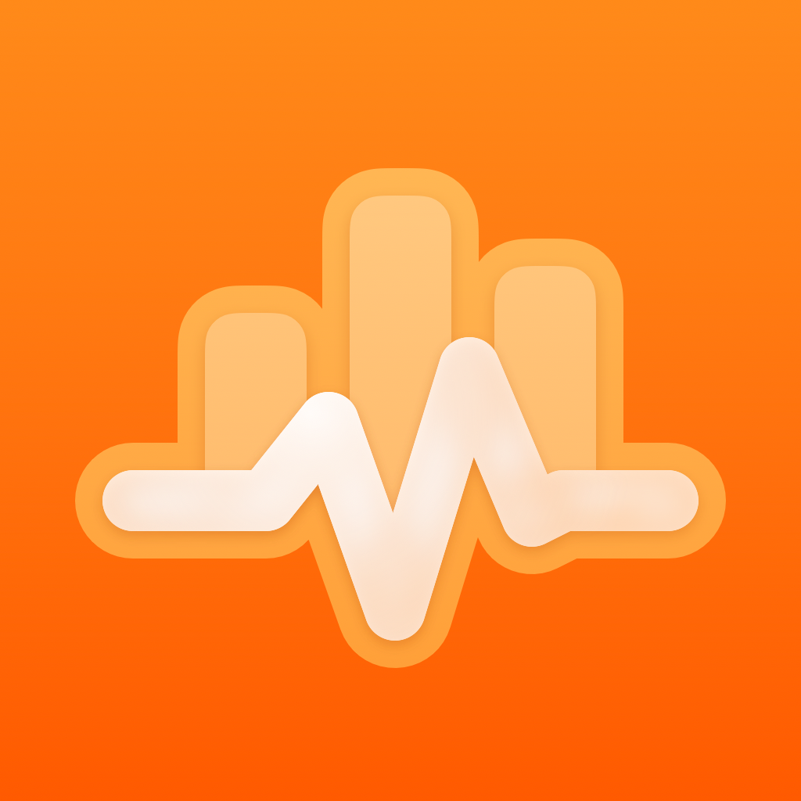
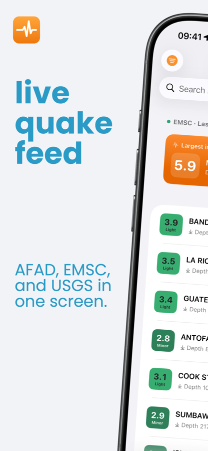
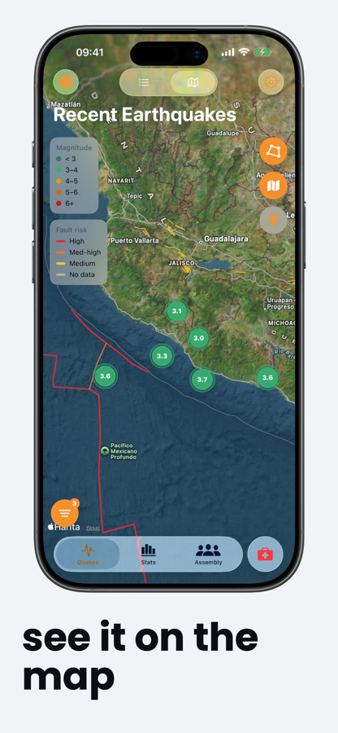
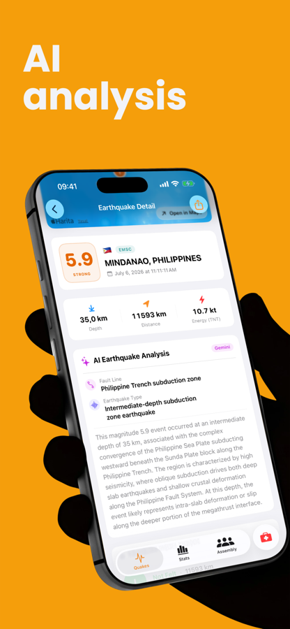
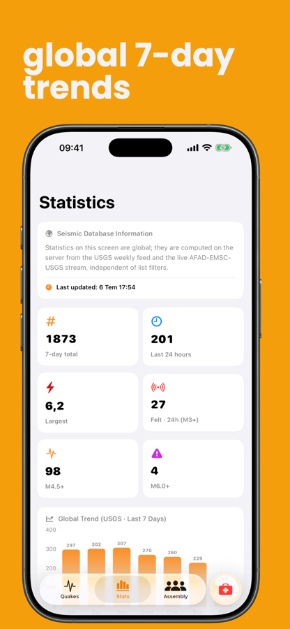
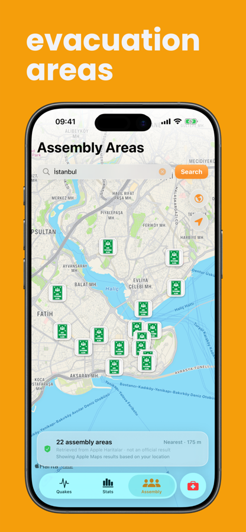
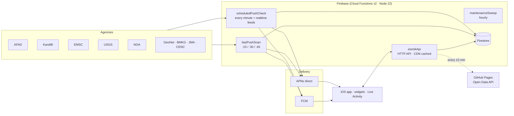

<div align="center">



# Sismik

**Real-time earthquake tracking for iPhone and iPad — nine seismological agencies, one calm interface.**<br>
**iPhone ve iPad için gerçek zamanlı deprem takibi — dokuz sismoloji ajansı, tek sade arayüz.**

[](https://apps.apple.com/tr/app/sismik-deprem-takibi/id6787776158)


[](https://kayaonur607.github.io/sismik/)
[](LICENSE)

[English](#english) · [Türkçe](#türkçe) · [Open Data API](api/README.md)







</div>

---

## English

### Overview

Sismik merges the public catalogues of **AFAD, Kandilli (KOERI), EMSC, USGS, NOA, GeoNet, BMKG, JMA and CENC** into one live feed. When several agencies report the same physical earthquake, it is shown once, and the record from the official agency for that region is preferred. The app has no ads and no third-party trackers, and it works without an account.

### Features

| Area | What it does |
|---|---|
| **Live feed** | 24-hour list from nine agencies, cross-agency de-duplication, magnitude/source/sort filters, a "felt near you" card |
| **Notifications** | Places-based alerts (home, work, family…) with per-place radius and magnitude, Critical Alerts, custom sounds, "Felt / Not felt" actions. Free tier: one place within 50 km plus worldwide M6.0+ |
| **Map** | Clustered MapKit map, GEM global active faults, density layer, aftershock zones, regional time-lapse playback |
| **Earthquake detail** | Estimated intensity (MMI) at your location, USGS ShakeMap, ORFEUS RRSM measured ground motion, aftershock sequence (Gardner–Knopoff), Reasenberg–Jones aftershock probability, Gemini-powered seismological summary |
| **Live Activities** | Aftershock tracking on the Lock Screen and Dynamic Island. During major events, APNs broadcast channels update it even when the app is closed |
| **Emergency** | Nearest assembly areas and hospitals (OpenStreetMap), offline compass to a safe place, whistle, siren, SOS flashlight, trapped mode, first-aid guide with a CPR metronome, family plan, local emergency number |
| **Risk profile** | Fault proximity, M5+ history within 100 km and building-age guidance for any location |
| **Tsunami** | NOAA PTWC/NTWC, JMA and BMKG tsunami flags, delivered to affected users for free |
| **System integration** | Widgets, Siri and Shortcuts, Home Screen quick actions, universal links, iPad and iPhone Duo adaptive layouts |
| **Languages** | 14: Turkish, English, German, Spanish, French, Italian, Japanese, Russian, Arabic, Greek, Portuguese (BR), Indonesian, Korean, Chinese (Simplified) |

### Architecture



- **iOS:** SwiftUI with `@Observable`, MapKit, Swift Charts, ActivityKit, WidgetKit, App Intents and StoreKit 2 with RevenueCat. Targets iOS 18+.
- **Backend:** TypeScript on Cloud Functions v2. The 24-hour list is a gzip-compressed snapshot document. Push delivery uses an in-memory spatial index and delta sync for device changes, and physical-event locks prevent duplicate alerts.
- **Cost design:** list responses are cached by the CDN, and Firestore is read through snapshots rather than per-quake documents. TTL policies handle cleanup. The public API is served by GitHub Pages.

### Open Data API

You can use free, read-only JSON and GeoJSON feeds without an API key. **[Documentation →](https://kayaonur607.github.io/sismik/)** · [`api/README.md`](api/README.md)

```sh
curl https://kayaonur607.github.io/sismik/v1/earthquakes/turkiye.json
```

The app's own backend endpoints (`functions/`) serve the iOS client only. They are rate-limited and may change at any time, so use the Open Data API instead. They are documented in [`functions/README.md`](functions/README.md).

### Getting started

**Requirements:** Xcode 27+, an iOS 18+ simulator or device, and Node.js 22.

```sh
git clone https://github.com/kayaonur607/sismik.git
cd sismik

# 1) Client keys (git-ignored) — see Config/
cp Config/AppKeys.swift.example Sismik/Services/AppKeys.swift      # RevenueCat public SDK key
cp Config/GoogleService-Info.example.plist Sismik/GoogleService-Info.plist   # or your own Firebase file

# 2) Open in Xcode, choose your team and bundle identifier, then run
open Sismik.xcodeproj

# 3) Backend
cd functions && npm ci && npm test
```

To use your own backend, set `BackendConfig.swift` to your Firebase project and create the secrets with `firebase functions:secrets:set`: `GEMINI_API_KEY`, `REVENUECAT_*`, `APNS_AUTH_KEY`, `APNS_KEY_ID`, `APNS_TEAM_ID`, `ASC_WEBHOOK_SECRET` and the optional `TWITTER_*`. Run `node Scripts/strings.py check` to validate translations.

### Privacy and security

- No ads, no analytics SDKs and no accounts. Medical ID, family plan and saved places stay on the device.
- The server stores only what push delivery needs: an anonymous token, notification places and preferences. Inactive devices are deleted after 60 days.
- Credentials are never committed. Server secrets live in Google Secret Manager, and client keys come from git-ignored files (see [`Config/`](Config)). Report vulnerabilities as described in [SECURITY.md](SECURITY.md).

> [!IMPORTANT]
> Sismik is **not** an earthquake early-warning system. Data is published by the agencies at their own pace. In an emergency, follow AFAD and your local authorities.

---

## Türkçe

### Genel bakış

Sismik, **AFAD, Kandilli (KRDAE), EMSC, USGS, NOA, GeoNet, BMKG, JMA ve CENC** kataloglarını tek bir canlı akışta birleştirir. Aynı fiziksel deprem birden fazla ajans tarafından yayımlandığında bir kez gösterilir ve bölgenin resmî ajansının kaydı tercih edilir. Uygulamada reklam ya da üçüncü taraf izleyici yoktur; hesap açmadan kullanılır.

### Özellikler

| Alan | Neler sunar |
|---|---|
| **Canlı akış** | Dokuz ajanstan 24 saatlik liste, ajanslar arası tekilleştirme, büyüklük/kaynak/sıralama filtreleri, "yakınında hissedilmiş olabilir" kartı |
| **Bildirimler** | Yer tabanlı uyarılar (ev, iş, aile…), her yer için yarıçap ve büyüklük, Kritik Uyarılar, özel sesler, "Hissettim / Hissetmedim" düğmeleri. Ücretsiz: 50 km'ye kadar bir yer ve dünya geneli M6,0+ |
| **Harita** | Kümelenmiş MapKit haritası, GEM küresel aktif faylar, yoğunluk katmanı, artçı alanları, bölgesel zaman atlamalı oynatma |
| **Deprem detayı** | Konumunda tahmini şiddet (MMI), USGS ShakeMap, ORFEUS RRSM ölçülen yer hareketi, artçı dizisi (Gardner–Knopoff), Reasenberg–Jones artçı olasılığı, Gemini destekli sismolojik özet |
| **Canlı Etkinlikler** | Kilit Ekranı ve Dynamic Island'da artçı takibi; büyük olaylarda APNs yayın kanalıyla uygulama kapalıyken de güncellenir |
| **Acil durum** | En yakın toplanma alanı ve hastaneler (OpenStreetMap), güvenli yere çevrimdışı pusula, düdük, siren, SOS feneri, enkaz modu, KPR ritimli ilk yardım rehberi, aile planı, bulunduğun ülkenin acil numarası |
| **Risk profili** | Herhangi bir konum için fay yakınlığı, 100 km içindeki M5+ geçmişi ve bina dönemi değerlendirmesi |
| **Tsunami** | NOAA PTWC/NTWC, JMA ve BMKG tsunami işaretleri; etkilenen kullanıcılara ücretsiz iletilir |
| **Sistem entegrasyonu** | Widget'lar, Siri ve Kestirmeler, ana ekran hızlı eylemleri, evrensel bağlantılar, iPad ve iPhone Duo uyarlanabilir düzen |
| **Diller** | 14 dil: Türkçe, İngilizce, Almanca, İspanyolca, Fransızca, İtalyanca, Japonca, Rusça, Arapça, Yunanca, Portekizce (BR), Endonezce, Korece, Çince (Basitleştirilmiş) |

### Mimari

- **iOS:** SwiftUI (`@Observable`), MapKit, Swift Charts, ActivityKit, WidgetKit, App Intents, StoreKit 2 + RevenueCat. iOS 18 ve üzerini hedefler.
- **Sunucu:** Cloud Functions v2 üzerinde TypeScript. 24 saatlik liste gzip'li tek bir anlık görüntü belgesinde tutulur. Push teslimi bellek içi konumsal dizin ve cihaz değişikliklerini fark (delta) ile okuma kullanır; fiziksel olay kilitleri çift bildirimi önler.
- **Maliyet tasarımı:** Liste yanıtları CDN'de önbelleklenir. Firestore deprem başına belge yerine anlık görüntülerle okunur, temizliği TTL politikaları yapar. Açık API GitHub Pages'ten sunulur.

### Açık Veri API'si

API anahtarı gerektirmeyen, ücretsiz ve salt okunur JSON/GeoJSON akışları. **[Belgeler →](https://kayaonur607.github.io/sismik/)** · [`api/README.md`](api/README.md)

```sh
curl https://kayaonur607.github.io/sismik/v1/earthquakes/turkiye.json
```

Uygulamanın kendi sunucu uçları (`functions/`) yalnızca iOS istemcisine hizmet eder. Bu uçlar hız sınırlıdır ve haber verilmeden değişebilir; üçüncü taraf kullanımı için Açık Veri API'sini tercih edin. Belgeleri [`functions/README.md`](functions/README.md) dosyasındadır.

### Kurulum

**Gereksinimler:** Xcode 27+, iOS 18+ simülatör ya da cihaz, Node.js 22.

```sh
git clone https://github.com/kayaonur607/sismik.git
cd sismik

# 1) İstemci anahtarları (git dışı) — bkz. Config/
cp Config/AppKeys.swift.example Sismik/Services/AppKeys.swift
cp Config/GoogleService-Info.example.plist Sismik/GoogleService-Info.plist   # ya da kendi Firebase dosyanız

# 2) Xcode'da açın, takımınızı ve paket kimliğinizi seçip çalıştırın
open Sismik.xcodeproj

# 3) Sunucu
cd functions && npm ci && npm test
```

Kendi sunucunuzu kurmak için `BackendConfig.swift` dosyasını kendi Firebase projenize yönlendirin. Ardından `firebase functions:secrets:set` ile şu sırları tanımlayın: `GEMINI_API_KEY`, `REVENUECAT_*`, `APNS_AUTH_KEY`, `APNS_KEY_ID`, `APNS_TEAM_ID`, `ASC_WEBHOOK_SECRET` ve isteğe bağlı `TWITTER_*`. Çevirileri doğrulamak için `node Scripts/strings.py check` komutunu çalıştırın.

### Gizlilik ve güvenlik

- Reklam, analitik SDK'sı ya da hesap yoktur. Tıbbi kimlik, aile planı ve kayıtlı yerler yalnızca cihazda saklanır.
- Sunucu yalnızca bildirim için gerekenleri tutar: anonim token, bildirim yerleri ve tercihler. 60 gün etkin olmayan cihazlar silinir.
- Kimlik bilgileri depoya girmez. Sunucu sırları Google Secret Manager'da, istemci anahtarları git dışı dosyalarda tutulur (bkz. [`Config/`](Config)). Güvenlik açıklarını [SECURITY.md](SECURITY.md) üzerinden bildirin.

> [!IMPORTANT]
> Sismik bir deprem **erken uyarı sistemi değildir**. Veriler ajanslar tarafından kendi hızlarında yayımlanır. Acil durumda AFAD'ın ve yerel yetkililerin talimatlarına uyun.

---

## License · Lisans

The source code is released under the [MIT License](LICENSE). The "Sismik" name, logo and App Store assets are not covered by the license and may not be used to publish a derivative app. Earthquake data belongs to the originating agencies.

Kaynak kod [MIT Lisansı](LICENSE) ile yayımlanmıştır. "Sismik" adı, logosu ve App Store görselleri lisans kapsamında değildir; türev bir uygulama yayımlamak için kullanılamaz. Deprem verileri kaynak ajanslara aittir.

© 2026 Onur Kaya
